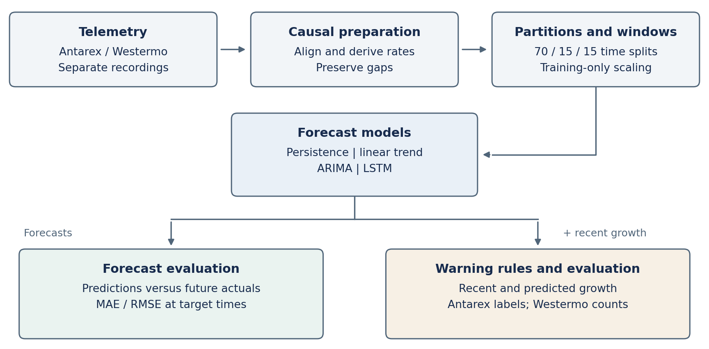
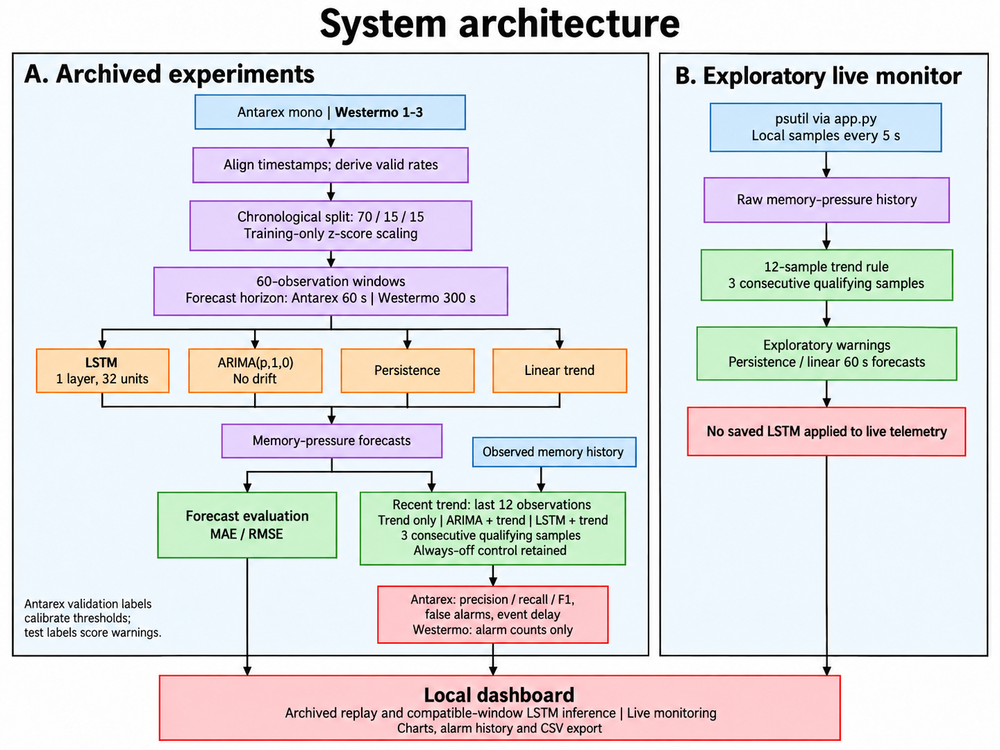
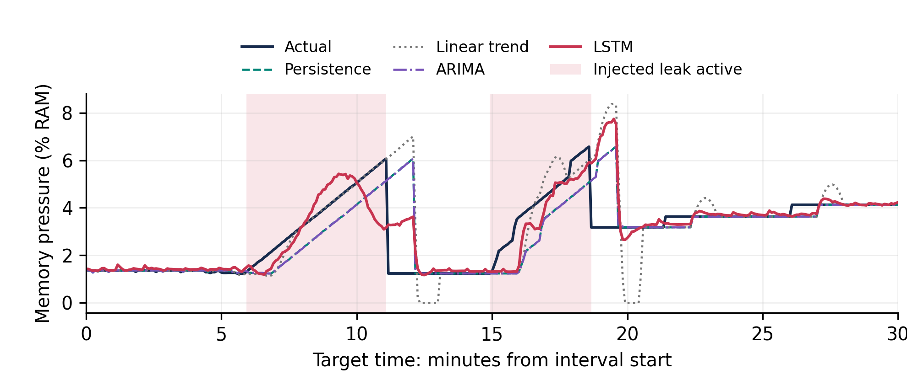
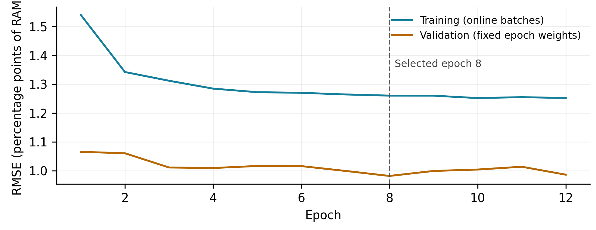
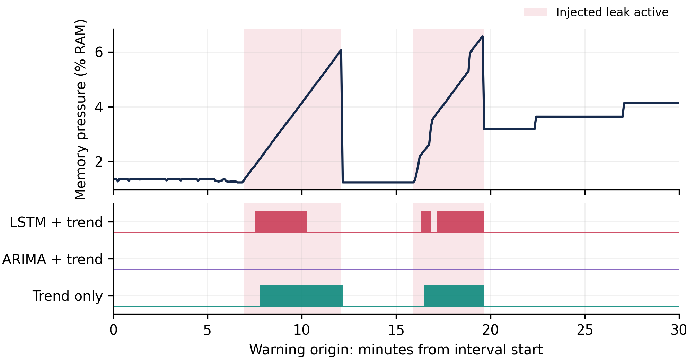

# Predictive Memory Leak Detection Using Time Series Analysis

> Preliminary research draft | 15 September 2026 | Sections 1-8

## 1. Introduction

Memory leaks occur when software retains allocated memory that is no longer needed. In long-running applications, repeated retention can reduce available memory and contribute to performance degradation or failure. However, increasing memory use can also reflect legitimate workload changes or caching, so utilization alone cannot confirm a leak. Prior work has explored detecting leak-like growth from memory-utilization time series without inspecting an application's internal objects [1].

Operating-system telemetry provides a basis for studying this behavior over time. Memory measurements describe resource availability; CPU activity, page faults, swap activity and disk throughput can provide workload context when available and informative. Forecasting uses past measurements to estimate a future memory value. Assi et al. compared Box-Jenkins and long short-term memory (LSTM) models for Windows performance forecasting [2]. Their comparison motivates evaluating an LSTM against simpler alternatives before attributing practical value to model complexity.

Accurate forecasting and useful leak warnings are distinct objectives. A model may predict most memory values closely while missing a brief period of sustained growth. A sensitive growth rule may identify injected leaks while also triggering during ordinary activity. Forecast error alone cannot establish detection quality. This study therefore asks whether improved memory forecasts translate into better warnings, assessed through recognition of labeled leak intervals and alarms outside those intervals.

The implemented pipeline forecasts a memory-pressure proxy defined as one minus the ratio of available memory to total physical memory. This quantity describes memory availability; it is not an estimated probability of a leak. Persistence, local linear extrapolation and a restricted autoregressive integrated moving average (ARIMA) baseline are compared with a small multivariate LSTM. Each recording is divided chronologically into training, validation and test periods. Learned preprocessing parameters are fitted on training data, and model and warning settings are selected using validation data. Forecasts are evaluated using mean absolute error and root mean squared error; warning behavior is assessed separately.

The pilot combines two complementary experimental settings without merging their timelines. The Antarex HPC Fault Dataset supplies real telemetry collected under controlled fault injection, including labeled memory-leak intervals [3]-[5]. Its CPU-MEM_mono block supports forecasting and leak-warning evaluation. Westermo provides industrial test-system telemetry [6]; systems 1-3 are used as separate forecasting experiments. Their leak status is unknown, so alarms on Westermo cannot be scored as confirmed true or false leak detections.

The study contributes a reproducible pilot comparison, a separate evaluation of trend-only and forecast-assisted warning rules, and a local prototype for replaying the verified experiments. Conclusions are limited to the observed workloads and available labels. The experiments measure recognition after leak injection begins; they do not establish warning before memory exhaustion or prevention of system failure.

## 2. Literature Survey

### 2.1 Software aging and resource exhaustion

Software aging research connects prolonged execution with accumulated internal errors and resource depletion. Huang et al. formalized software rejuvenation as preventive renewal of a running application [7]. This establishes that proactive action against aging is a longstanding research direction. It also separates two questions: whether degradation can be recognized and when an intervention should occur. A memory forecast alone answers neither question completely.

Vaidyanathan and Trivedi modeled resource exhaustion using both elapsed time and workload state, based on measurements from UNIX systems [8]. Grottke et al. subsequently examined resource usage in a web server under an artificial workload and considered the implications for rejuvenation [9]. These studies motivate including workload context when interpreting memory growth. They also caution against equating a trend observed under one workload with a universal aging rate. The present pilot retains informative CPU and memory-related measurements, while treating each recording as a separate experiment.

### 2.2 Runtime instrumentation and heap analysis

Detailed memory analysis can expose information that aggregate telemetry cannot. Nethercote and Seward describe Valgrind as a framework for dynamic binary instrumentation, including the shadow-state machinery used by analysis tools such as Memcheck [10]. Such instrumentation can support diagnosis close to program execution, whereas system-level memory measurements summarize the combined effects of many activities.

Mitchell and Sevitsky's LeakBot ranks suspicious Java data structures and tracks their evolution to support automated diagnosis [11]. Jump and McKinley's Cork associates growing heap structures with types by working alongside garbage collection [12]. Weninger et al. visualize the evolution of grouped heap objects through time-travel and timeline views in AntTracks [13]. These approaches help investigate where retained objects accumulate. Our telemetry pipeline does not collect object-reference graphs or allocation sites, so its warnings cannot identify the responsible object or source-code location.

Beneder et al. evaluated two measurement-based runtime algorithms on an embedded Linux room controller [14]. Their work is particularly relevant because it studies leak recognition using operating-system measurements on a deployed device. It also shows why measurements and thresholds require validation in the intended environment. Results from an HPC recording do not by themselves validate a warning rule on a Windows laptop or an embedded controller.

### 2.3 Telemetry-based detection and production services

Jindal et al. introduce Linear Backward Regression, Precog and their variants for detecting leaks from system memory utilization without internal application knowledge [1]. This is close to the observation level used in the present project, although our local trend rule is not a reproduction of those algorithms. The comparison of trend-only and forecast-assisted rules asks whether a learned forecast adds useful information to recent growth under a common evaluation protocol.

RESIN takes a broader production-service approach: it first identifies suspicious leaking entities, then selectively collects heap snapshots for diagnosis and applies mitigation [15]. Its staged design distinguishes detection from root-cause analysis and operational response. Our prototype addresses forecasting, warning evaluation and replay, without implementing comparable diagnosis or automated mitigation. Similarly, the Antarex fault-injection setting [3]-[5] provides controlled labels, while Westermo's industrial measurements [6] provide workload diversity. These sources support complementary experiments, with different limits on what can be concluded about leaks.

### 2.4 Statistical, neural and hybrid forecasting

Box, Jenkins and Reinsel describe statistical time-series modeling through model identification, estimation and checking [16]. Hyndman and Athanasopoulos emphasize comparing forecasting methods against simple benchmarks, including forecasts that repeat the latest observation [17]. These foundations motivate the project's persistence and statistical baselines. Our ARIMA search is deliberately restricted, so its results characterize that implemented configuration rather than every possible ARIMA model. Local linear extrapolation provides an additional comparison that explicitly projects recent growth.

Hochreiter and Schmidhuber introduced LSTM to address difficulties in learning dependencies across extended sequences [18]. Gers et al. added an adaptive forget gate for continual prediction [19]. These mechanisms justify considering recurrent models for telemetry histories, but they do not guarantee that an LSTM will outperform a simple predictor on a particular horizon. Assi et al.'s Windows study directly compares Box-Jenkins and LSTM forecasting [2], supporting an empirical comparison rather than an assumed neural-model advantage.

Hybrid forecasting is a distinct design choice. Zhang combines ARIMA with an artificial neural network to model linear and nonlinear behavior [20]; this is an ARIMA-ANN method, not specifically an LSTM. Samal and Kumar examine an ARIMA-LSTM hybrid for software fault prediction using open-source software datasets [21]. Battisti et al.'s hLSTM-Aging combines moving-average and convolutional LSTM components for software-aging forecasts [22]. These works provide relevant alternatives, but their targets and settings differ from the present memory-pressure proxy. Our implementation evaluates ARIMA and LSTM separately; it does not implement either hybrid architecture.

Model complexity also needs a strong baseline. Zeng et al. demonstrate competitive simple linear models in long-term forecasting comparisons with Transformers [23]. Their benchmark is different from our short-horizon telemetry task, so its ranking cannot be transferred directly. Its methodological lesson is applicable: a more complex architecture should earn its place through a fair comparison on the chosen data, horizon and metrics.

### 2.5 Trend testing and warning rules

Mann's nonparametric trend work provides a foundation for rank-based assessment of ordered observations [24]. Sen's estimator uses pairwise slopes to estimate a trend robustly [25]. Hamed and Rao show that serial correlation affects the behavior of the Mann-Kendall test and propose a variance correction for autocorrelated data [26]. These distinctions matter for frequently sampled telemetry, where neighboring measurements are related. A positive slope is not itself a statistically significant trend, and significance would still not establish a leak's cause. The implemented warnings use local least-squares slopes, validation-selected thresholds and consecutive qualifying observations. Mann-Kendall testing and Sen's slope remain possible extensions, not components of the current experiments.

### 2.6 Temporal validation and data leakage

Tashman explains how holdout periods, forecast origins and model updating affect out-of-sample comparisons [27]. Bergmeir et al. show that ordinary cross-validation can be valid for particular autoregressive settings with uncorrelated model errors [28]. This qualified result should not be interpreted as blanket permission to randomly split overlapping telemetry windows. The present chronological split reflects the intended task of forecasting later observations from earlier data.

Albelali and Ahmed's preprint examines leakage associated with sequence construction and validation design in LSTM forecasting [29]. Kapoor and Narayanan document broader leakage problems in machine-learning-based research and argue for explicit reporting of data separation and scientific claims [30]. Together, these sources motivate documenting when splitting, window construction, scaling and model selection occur. In our pipeline, split boundaries are established before eligible windows are formed, learned scaling uses training data, and validation data guide model and warning choices. Test data are reserved for the reported comparison. This design supports an auditable pilot; it does not eliminate the need for further validation across workloads and repeated training runs.

### 2.7 Forecast error and leak-warning evaluation

Hyndman and Koehler discuss how forecast-error measures can behave differently and become misleading under unsuitable conditions [31]. In this project, MAE and RMSE describe errors in the forecast memory value. Expressing them in percentage points of total RAM makes their units explicit. They do not measure the probability that a warning is correct. For the classification task, Saito and Rehmsmeier explain why precision-recall analysis is informative when positive and negative cases are imbalanced [32]. This motivates reporting precision and recall alongside false-alarm behavior, rather than relying on overall classification accuracy.

Time-series events also occupy intervals. Tatbul et al. extend precision and recall to range-based anomalies and make domain preferences explicit [33]. Kim et al. show how point adjustment can inflate reported anomaly-detection performance [34]. The present evaluation therefore reports actual warning decisions at individual timestamps separately from event detection and delay. It does not replace all timestamps in a detected leak interval with successful predictions. Its event definition is project-specific rather than an implementation of Tatbul et al.'s complete scoring framework.

Wu and Keogh identify flaws in widely used anomaly benchmarks that can distort apparent progress [35]. Schmidl et al. compare diverse time-series anomaly detectors across many datasets, examining effectiveness, efficiency and robustness [36]. These studies reinforce the need for explicit dataset scope, strong comparisons and clear label semantics. They do not turn the unlabeled Westermo recordings into leak benchmarks. For Antarex, recognition after a recorded injection begins must likewise be distinguished from warning before memory exhaustion.

### 2.8 Implications for the present study

The reviewed work already establishes predictive aging analysis, telemetry-based leak detection, hybrid forecasting and staged production diagnosis. The present study builds on these directions through a reproducible pilot that evaluates forecasting and warning behavior separately. Its contribution is the documented comparison on the selected recordings and the examination of the trade-off between warning precision, coverage and timing. Broader superiority, deployment reliability and prevention of exhaustion require experiments beyond the current evidence.

## 3. Research Gap

The literature establishes that anticipating software degradation and detecting leaks from telemetry are existing research directions. Resource-exhaustion models incorporate time and workload [8], while LBR and Precog investigate memory-utilization trends [1]. Statistical and neural forecasting have also been compared for operating-system performance [2], and RESIN combines detection, diagnosis and mitigation in production [15]. These findings motivate a more specific empirical question than whether predictive memory analysis is possible.

The question addressed here is whether improved short-horizon memory forecasts produce useful changes in leak-warning behavior on the selected recordings. Forecasting and warning evaluation measure different outcomes: aggregate MAE or RMSE does not reveal how often a warning identifies an ongoing leak, how many alarms occur outside labeled leak intervals, or how quickly an event is recognized. The distinction between point and interval evaluation further affects interpretation [31]-[34]. A common temporal protocol is therefore needed to compare forecast quality and the associated warning trade-offs together.

Data availability constrains this investigation. Antarex provides controlled fault-injection telemetry [3]-[5], whereas Westermo provides industrial workload measurements [6]. In the audited pilot, only Antarex supplies confirmed injection intervals for leak scoring. Westermo supports a separate assessment of forecasting behavior and descriptive alarms, but cannot establish detection accuracy. Treating the two settings according to their evidence avoids inferring general leak-detection performance from unlabeled data.

This study addresses that evaluation question through a reproducible comparison of simple predictors, a small multivariate LSTM and fixed-form warning rules. The contribution is an empirical assessment of their accuracy, warning coverage and false-alarm trade-offs within the pilot. It does not depend on claiming a new forecasting architecture or that the reviewed literature has never combined prediction and detection. Whether the findings extend to new workloads, naturally occurring leaks or memory-exhaustion outcomes remains open.

## 4. Problem Statement

### 4.1 Forecasting and warning tasks

Given a chronological stream of operating-system measurements, the task is to forecast future memory availability and assess whether recent and predicted growth can support useful leak warnings. At each eligible observation time t, the predictor receives measurements available through t and estimates the memory-pressure proxy at t + h. The target is y(t) = 1 - available_memory(t) / total_memory(t), expressed as a fraction of total physical RAM. It summarizes resource availability; a forecast of this quantity is not a calibrated probability of a leak.

The pilot provides up to 60 observations of history and uses a 60-second forecast horizon for Antarex and a 300-second horizon for Westermo. Models are fitted separately for each recording. At the forecast origin, a warning rule evaluates recent observed growth, either alone or together with predicted growth. Its inputs exclude future observations and event labels. Antarex labels are used to select warning thresholds on validation data and to score frozen rules on test data. The overall warning procedure therefore includes supervised calibration even though the forecasting model learns a continuous telemetry target.

### 4.2 Research questions and evaluation objectives

RQ1 - Forecast quality: How does the multivariate LSTM compare with persistence, local linear extrapolation and the restricted ARIMA baseline on the same held-out forecast origins? The objective is to report MAE and RMSE in percentage points of total RAM for each recording. This compares complete predictors; isolating the benefit of additional features would require a separate ablation study.

RQ2 - Warning usefulness: What changes when an ARIMA or LSTM forecast is added to the recent-growth rule? The objective is to compare unadjusted timestamp-level precision, recall and F1, false alarm starts per observed non-leak hour, and event detection with delay. Detected-event delays must be accompanied by missed-event counts, so fast recognition of a subset cannot conceal incomplete coverage.

RQ3 - Behavior across workload settings: How do separately fitted forecasts perform on the selected Westermo systems, and what alarm activity results when the Antarex warning thresholds are transferred unchanged? The objective is to report forecast errors and descriptive alarm counts. Without verified Westermo leak labels, this question cannot measure warning precision, recall or false-alarm rates there.

### 4.3 Scope of the present contribution

The practical deliverable is a reproducible telemetry pipeline with saved predictions, explicit warning decisions, quantitative evaluation and a local replay interface. Model settings and thresholds follow the documented training and validation process; the reported test comparison evaluates later observations. These research questions summarize that pilot protocol and should not be interpreted as a preregistered confirmatory study.

The original aim of warning before leaks become critical remains a longer-term objective. The present labeled task recognizes an injection that has already started, and the audited Antarex block contains no crossing of the candidate 80% memory-pressure threshold. Consequently, event delay measures time after injection onset rather than lead time before exhaustion. Establishing pre-exhaustion warning, crash prevention, root-cause diagnosis or acceptable continuous-monitoring overhead requires additional evidence. Successful completion of this pilot is a transparent comparison with a demonstrable prototype, including unfavorable outcomes where observed, rather than an assumed LSTM advantage.

## 5. Proposed Methodology

### 5.1 Pipeline overview

The implemented method has two connected evaluation paths: forecasting a future memory value and assessing warnings derived from recent and predicted growth. Figure 1 summarizes the workflow. Each recording is processed independently, with its own temporal partitions, selected features, scaling parameters and forecasting models. Antarex supports labeled warning evaluation; Westermo supports forecasting and descriptive alarm analysis. The saved Colab runs provide the experimental artifacts used throughout this study.

Figure 1. Implemented pipeline, repeated independently for each recording. Training data determine learned preprocessing and model parameters; validation data select forecast settings and calibrate Antarex warning thresholds. The two evaluation paths retain their distinct targets and label requirements.

### 5.2 Causal alignment and feature construction

Antarex telemetry streams are aligned on a five-second grid using the most recent measurement at or before each grid timestamp, with a maximum permitted age of 2.1 seconds. Duplicate or non-increasing source timestamps are rejected. Cumulative page-fault, swap and disk counters are converted to rates using counter differences divided by actual elapsed source-measurement time. Negative differences, non-positive time intervals or intervals exceeding 7.2 seconds invalidate the affected rate. CPU fractions use differences of non-overlapping tick categories, excluding guest counters to avoid double counting.

Westermo retains its native 30-second grid and published CPU and disk rates. Missing timestamps and unavailable observations remain gaps; rates are not differenced again and gaps are not interpolated. Rows are eligible only when source data are available and candidate features satisfy the finite-value, non-negativity and applicable range checks. The target remains the memory-pressure proxy defined in Section 4.

Antarex leak episodes are reconstructed from paired injection start/end records and checked against the supplied fault labels. Intervals include their start and exclude their end. Fault types, episode identifiers, commands, timestamps and labels are excluded from predictor inputs. Westermo leak labels remain unknown. These steps preserve dataset provenance while keeping evaluation annotations separate from telemetry features [3]-[6].

### 5.3 Temporal partitions, scaling and windows

Each recording's time extent is divided chronologically into 70% training, 15% validation and 15% test periods. Boundaries are established before forecast windows are constructed. For Antarex, the first row of each partition is excluded because its rate features could depend on an observation from the preceding partition. Features with training standard deviation at most 10^-12 are removed. Each retained feature is standardized using its valid-training-row mean and population standard deviation; the same transformation is applied unchanged to later partitions.

A forecasting sample contains 60 observations ending at the origin and one target 12 grid steps ahead for Antarex or 10 steps ahead for Westermo. The entire interval from history start through target must lie within one valid contiguous segment and one partition. Windows crossing a gap or split boundary are excluded. Eligibility uses complete recorded coverage for offline evaluation; the predictor itself receives only the history through its origin. This coverage restriction must accompany interpretation of warning results.

Evaluation uses rolling forecast origins. Earlier observations within a held-out partition become available as time advances, but future measurements never enter the current prediction. Fitted ARIMA coefficients and LSTM weights remain fixed during validation and test forecasting. This design follows temporal evaluation principles [27]-[30]. Compact feature arrays and window indices allow batches to be assembled without materializing every overlapping sequence in memory.

### 5.4 Forecasting baselines

Persistence predicts the last observed memory-pressure value at every horizon. Local linear extrapolation fits a least-squares line to the latest 12, 30 or 60 memory values and projects it to the target time; validation RMSE selects the history length, with ties favoring the shorter history. The line is recalculated from observations available at each origin. These benchmarks test whether the additional complexity of a learned model is useful [17].

The statistical baseline is restricted to ARIMA(p,1,0) without drift, with p selected from 1, 3 and 5. A Yule-Walker autoregression is fitted to first differences from the longest contiguous valid training segment; the earliest segment wins a length tie. The fitted coefficients recursively predict future differences, which are accumulated from the current observed level. No future observed differences are used. Validation RMSE selects the order, with ties favoring smaller p. This is a limited statistical comparator, rather than a full Box-Jenkins identification and diagnostic search [2], [16].

All three baselines use the memory target alone. Every model's predictions are clipped to the target's physical range [0,1] for scoring; raw predictions and clipping counts are also retained. Forecast origins, target times and clipping rules are shared with the LSTM comparison.

### 5.5 Multivariate LSTM forecasting

The neural predictor uses one unidirectional LSTM layer with 32 hidden units and a linear output layer applied to the final hidden output. It predicts one future memory-pressure value from the 60-row standardized feature history. Hidden and cell states reset for each window, so state does not carry across batches or partitions. The architecture uses the established LSTM mechanism [18], [19] without a hybrid ARIMA stage, bidirectional layer or dropout.

Training minimizes mean squared error on the target standardized with the training memory-pressure mean and standard deviation. Adam uses a learning rate of 0.001, batch size 64 and gradient-norm clipping at 1.0. Seed 42 is reset independently for each recording. To reduce computation and redundant overlap, training retains every twelfth eligible Antarex origin and every fourth Westermo origin before shuffling these already-separated training windows. Validation and test retain all eligible origins; the baselines and LSTM are not claimed to use identical training subsets.

Training runs for at most 20 epochs and stops after four successive epochs without a new validation-RMSE minimum. Validation predictions are transformed back to memory-pressure units and clipped before checkpoint selection. The lowest-validation-RMSE weights are retained. The model is trained for forecasting, so warning quality requires a subsequent evaluation rather than following directly from its training loss.

### 5.6 Forecast-assisted warning rules

At origin t, let g(t) be the least-squares slope over the latest 12 memory-pressure observations, including t, converted to percentage points of total RAM per minute. For model m, let f_m(t) denote its clipped forecast for t + h, where h is in seconds. The forecast-growth score is q_m(t) = 100[f_m(t) - y(t)] / (h/60). Trend-only uses score g(t); ARIMA-assisted and LSTM-assisted rules use min(g(t), q_m(t)). Thus an assisted rule requires both observed and predicted growth to meet its positive threshold. An always-off control is retained.

A warning becomes active on the third consecutive eligible origin whose score is at least the threshold. It stops as soon as the condition fails, and consecutive counts reset at gaps and split boundaries. The 12-point trend spans 55 seconds on Antarex and 330 seconds on Westermo. Three qualifying observations span 10 and 60 seconds, respectively, from the first qualifying sample to warning activation. This confirmation rule is a fixed heuristic, not a Mann-Kendall significance test or a reproduction of Precog [1].

Each scoring rule independently selects a threshold from 0.01, 0.025, 0.05, 0.1, 0.2, 0.4, 0.8, 1.6 and 3.2 percentage points per minute, plus a disabled option. Selection maximizes unadjusted Antarex validation F1, breaking ties by fewer false-positive origins and then the higher threshold; disabled ranks highest in the final tie-break. The trend length and confirmation count are fixed. Selected thresholds are saved before warning test scoring and transferred unchanged to Westermo's separately fitted forecasts. Validation labels therefore calibrate warnings, while labels never enter an individual warning score.

### 5.7 Forecast and warning evaluation

For N paired target values and predictions, MAE is the mean absolute forecast error and RMSE is the square root of mean squared forecast error. Both are multiplied by 100 to express errors in percentage points of total RAM [31]. All models are evaluated at matching eligible origins within each recording. Figures place predictions at target timestamps and use predefined intervals; aggregate metrics use the complete eligible test set.

Antarex warning decisions are scored at origin timestamps against active-injection labels. Precision is TP/(TP + FP), recall is TP/(TP + FN), and F1 is 2TP/(2TP + FP + FN). Ratios with zero denominators are recorded as undefined. Decisions remain unadjusted: detecting one point does not turn an entire event into true positives [32]-[34]. An alarm start is a transition from inactive to active, including activation after a coverage gap. False alarm starts per observed non-leak hour divide starts outside leak intervals by eligible non-leak origins times cadence, converted to hours. Non-leak intervals may contain other injected faults; they are not assumed healthy. False-positive duration is also retained to capture persistent alarms after a leak ends.

Event evaluation includes only episodes with complete eligible-origin coverage during the event and a covered sample immediately before onset. Exclusions and reasons are saved. Detection requires a new alarm start inside the half-open event interval; an alarm already active before onset receives no new detection credit. Delay is the first qualifying alarm-start time minus injection onset. Event recall and missed counts accompany median and 90th-percentile delays among detected events only. Westermo has no confirmed leak labels, so only warning fractions, alarm starts and starts per observed hour are reported there.

### 5.8 Reproducibility and prototype presentation

Each stage saves its inputs' hashes, configuration, selected settings and outputs in manifest-checked packages. Forecast tables retain origins, target times, actual values and predictions; warning tables retain scores, states and event outcomes. Saved metrics and model inference are checked against their source artifacts. Earlier forecast test results were inspected during staged development before the warning protocol was defined; warning thresholds still use validation data only. This remains a development pilot with a reused validation partition, not an independent confirmatory test.

The local prototype replays these verified artifacts while revealing observations only through the replay cursor. It also supports inference with the saved LSTM weights on compatible archived input windows. A separate local telemetry mode offers exploratory trend monitoring; it does not transfer the Linux-trained LSTM to incompatible Windows features. Demonstration functionality therefore remains distinct from evidence of validated continuous leak detection on a new machine.

<!-- pagebreak -->

### 5.9 System architecture

Figure 2 distinguishes the archived experimental path from the exploratory live monitor. Both feed the local dashboard, but only the archived path uses the trained LSTM and labeled Antarex warning evaluation. The live monitor uses raw memory-pressure histories and a separate trend rule. Forecast error metrics and warning metrics are computed through separate evaluation paths.

Figure 2. Implemented system architecture. Archived models use recording-specific features and training-only standardization. ARIMA- and LSTM-assisted rules combine their forecast growth with recent observed growth; the trend-only rule and always-off control provide comparisons. Antarex labels calibrate and evaluate warnings, while Westermo alarms remain descriptive. The live branch produces exploratory warnings and does not apply archived LSTM weights to incompatible local features.

## 6. Experimental Setup

### 6.1 Dataset scope and provenance

The primary recording is the CPU-MEM_mono block of the Antarex HPC Fault Dataset, version 1.0 [3]-[5]. Four telemetry streams covering approximately 12 days were audited: meminfo, vmstat, procstat and procdiskstats. Their median sampling interval is approximately 1.005 seconds; the experiment uses the five-second alignment described in Section 5. The block contains 228 deliberately injected leak episodes on a real machine. It does not represent a collection of naturally occurring production leaks.

The complete nested CPU-MEM_mono archive was recovered and checked against the publisher ZIP member's recorded size and CRC. The full outer ZIP was not completely downloaded, and its published MD5 was not verified. The experiment therefore uses the recovered, verified block without claiming validation of every Antarex archive or telemetry stream.

Westermo provides a separate industrial workload setting [6]. All 19 published CSV files were acquired and checked against their Git blob hashes and sizes at repository commit 47e0ccdc10c30e86327d6eb828ed48d164469fd4. Systems 1-3 were selected in numerical order before modeling and evaluated independently. Each spans 30 days on a native 30-second grid. Both sources are distributed under CC BY 4.0; attribution and source manifests are retained with the pilot packages.

### 6.2 Sampling and model inputs

Table 1 describes the processed recordings. Grid rows include unavailable or invalid observations; valid rows satisfy the preprocessing checks. Antarex excludes three rate-dependent partition-start rows. Westermo systems 1 and 2 preserve 652 and 8 missing grid observations, respectively; system 3 has none. These gaps affect the eligible windows rather than being filled with synthetic measurements.

Table 1. Processed pilot recordings. Cadence and forecast horizon are in seconds; inputs denote retained LSTM features.

| Recording | Grid rows | Valid rows | Inputs | Cadence / horizon |
|---|---:|---:|---:|---|
| Antarex mono | 207,361 | 207,358 | 7 | 5 / 60 |
| Westermo 1 | 86,401 | 85,749 | 8 | 30 / 300 |
| Westermo 2 | 86,401 | 86,393 | 7 | 30 / 300 |
| Westermo 3 | 86,401 | 86,401 | 8 | 30 / 300 |

Antarex retains memory pressure, anonymous memory and committed memory in GiB, CPU busy and iowait fractions, page faults per second and major page faults per second. Committed memory is not necessarily resident memory. Swap usage, swap-in, swap-out and the monitored disk read/write rates are constant in training and are removed from the model input array. They remain available in the unscaled audit table. Thus this block cannot test the benefit of varying swap or disk activity.

Westermo systems 1 and 3 retain memory pressure, swap usage in GiB, published CPU user/system/iowait rates, disk read/write rates and one-minute load. System 2 omits training-constant swap usage. Its CPU fields retain the publisher's aggregate rate units and are not converted into bounded utilization percentages. Page-fault fields are absent and are not fabricated. The baselines use only memory pressure; the LSTM uses the recording's retained feature set.

All recordings use a 60-observation input history. The first-to-last history span is 295 seconds for Antarex and 1,770 seconds for Westermo. Forecast horizons of 60 and 300 seconds are measured from the final input timestamp. Chronological training, validation and test fractions are 70/15/15 by recorded time extent; Table 2 gives counts after gap and boundary exclusions.

Table 2. Eligible forecast windows and retained LSTM training windows. Validation and test origins are shared by all four predictors.

| Recording | Eligible train | LSTM train | Validation | Test |
|---|---:|---:|---:|---:|
| Antarex mono | 145,081 | 12,091 | 31,032 | 31,032 |
| Westermo 1 | 59,691 | 14,923 | 12,891 | 12,891 |
| Westermo 2 | 60,412 | 15,103 | 12,891 | 12,745 |
| Westermo 3 | 60,412 | 15,103 | 12,891 | 12,891 |

The four recordings provide 69,559 test origins per forecasting method. Overlapping windows are correlated and are not independent trials. The LSTM training column reflects the fixed origin strides in Section 5; it is distinct from the count of all eligible training windows. ARIMA fitting instead uses the longest valid contiguous training segment: 145,152 observations for Antarex and 53,188, 60,481 and 60,481 for Westermo systems 1, 2 and 3.

### 6.3 Fixed settings and selected models

The candidate baselines and fixed LSTM configuration follow Section 5. Four independent LSTMs use one 32-unit recurrent layer, a linear output, seed 42, Adam at 0.001, batch size 64, gradient-norm clipping at 1.0 and a maximum of 20 epochs with patience four. Inference batches contain up to 256 windows. The seven-feature models have 5,281 trainable parameters; the eight-feature models have 5,409. Table 3 records validation-selected settings and checkpoints rather than settings selected by test performance.

Table 3. Retained forecasting configurations. Trend history is in observations; LSTM epochs show the selected checkpoint followed by the number of epochs run.

| Recording | Trend history | ARIMA order | LSTM epochs selected / run |
|---|---:|---|---|
| Antarex mono | 12 | (3,1,0) | 8 / 12 |
| Westermo 1 | 60 | (5,1,0) | 10 / 14 |
| Westermo 2 | 30 | (5,1,0) | 20 / 20 |
| Westermo 3 | 30 | (5,1,0) | 13 / 17 |

Persistence has no fitted hyperparameter. ARIMA was the baseline family with the lowest validation RMSE on each recording, but all three baseline families are retained in the test comparison. Westermo 2 reached the declared epoch limit; the other LSTMs stopped after four epochs without a new validation minimum. This is a single-seed experiment, with no repeated-seed or feature-ablation study.

### 6.4 Warning calibration and labeled coverage

Warning calibration uses the 31,032 eligible Antarex validation origins, including 1,707 leak-active origins. The frozen thresholds are 0.8 percentage points per minute for trend-only and 0.4 for LSTM-assisted warnings. ARIMA-assisted warnings select the disabled option because no fixed-grid candidate produced a validation warning; this choice is specific to the implemented score and grid. The always-off control remains disabled by definition. No threshold is recalibrated on Westermo or the test partition.

The Antarex test cohort contains 31,032 eligible origins: 1,933 leak-active and 29,099 non-leak. All 35 leak episodes intersecting this test interval satisfy the complete-coverage event criteria. These are evaluation denominators, not detection outcomes. Non-leak exposure includes other injected faults. The audited block peaks at approximately 42.24% memory pressure and never reaches the illustrative 80% reference threshold, so this setup cannot measure warning lead time before an observed exhaustion event. Westermo remains unlabeled and contributes only the separate forecasting and descriptive warning analyses.

### 6.5 Recorded execution environment

The four notebooks were executed in Google Colab's free tier. The saved LSTM runtime reports CPU execution on x86_64, two CPU worker threads and deterministic algorithms enabled; CUDA and cuDNN are absent from that run. GPU execution was not exercised. Table 4 reports recorded software versions, rather than substituting the versions requested by installation cells or used by the separate local reference run.

Table 4. Software versions recorded in the Colab artifacts. P: preprocessing; B: baselines; L: LSTM; W: warning evaluation.

| Component | Recorded version | Recorded stages |
|---|---|---|
| Python | 3.13.15 | P, B, L, W |
| NumPy | 2.1.3 | P, B, L, W |
| pandas | 2.2.3 | P, B, L, W |
| SciPy | 1.16.3 | B |
| statsmodels | 0.14.6 | B |
| PyTorch | 2.11.0+cpu | L |
| Matplotlib | 3.10.0 | B, L, W |

The baseline runtime records Matplotlib 3.10.0 despite its setup cell requesting 3.10.8. CPU model and assigned RAM were not captured; neither hardware specifications nor continuous-monitoring overhead are inferred from the saved stage timings.

### 6.6 Experimental artifacts

The four notebooks preserve manifest-checked preprocessing, baseline, LSTM and warning packages. The stages share prepared windows and scalers, with hashes linking inputs to configurations, selected weights and outputs. Complete Colab runs supply the reported analyses; earlier local runs remain separate.

## 7. Preliminary Results and Discussion

### 7.1 Held-out memory forecasting

Tables 5 and 6 report the complete Colab test results at the matching origins defined in Section 6. Lower values indicate smaller forecast errors. Models and checkpoints remain fixed by their validation selections. Results are reported separately for each recording because forecast horizons, features and workloads differ.

Table 5. Test RMSE in percentage points of total RAM. Antarex uses a 60-second horizon; Westermo uses 300 seconds.

| Recording | Persistence | Linear trend | ARIMA | LSTM |
|---|---:|---:|---:|---:|
| Antarex mono | 1.516596 | 1.743690 | 1.516401 | 1.216399 |
| Westermo 1 | 0.363477 | 0.375828 | 0.317915 | 0.295990 |
| Westermo 2 | 0.316791 | 0.348487 | 0.291166 | 0.257544 |
| Westermo 3 | 0.715420 | 0.818381 | 0.658167 | 0.608003 |

Table 6. Test MAE in percentage points of total RAM, on the same origins as Table 5.

| Recording | Persistence | Linear trend | ARIMA | LSTM |
|---|---:|---:|---:|---:|
| Antarex mono | 0.361399 | 0.377387 | 0.362521 | 0.358119 |
| Westermo 1 | 0.094208 | 0.145035 | 0.092984 | 0.099499 |
| Westermo 2 | 0.108831 | 0.143653 | 0.104707 | 0.116579 |
| Westermo 3 | 0.240245 | 0.328811 | 0.229737 | 0.251230 |

The LSTM has the lowest test RMSE on all four recordings. Relative to the validation-selected ARIMA baseline, the reductions are 19.78% on Antarex and 6.90%, 11.55% and 7.62% on Westermo systems 1-3. These are relative reductions in forecast error, not leak-detection accuracy. LSTM also has the lowest Antarex MAE, but ARIMA has the lowest MAE on every Westermo recording. RMSE weights larger errors more heavily than MAE [31]; the joint result indicates lower squared-error cost without uniformly lower average absolute error.

Persistence and ARIMA are nearly tied on Antarex: their RMSE differs by approximately 0.000196 percentage points. The selected no-drift ARIMA(3,1,0) has three first-difference coefficients near -0.01. Small corrections to recent differences are consistent with forecasts close to the last observed level. This explanation concerns the fitted restricted baseline; it does not imply that all ARIMA specifications behave like persistence. Linear extrapolation has the highest test RMSE on each recording, showing that extending recent growth alone does not improve this forecast comparison.

Antarex's saved origin-label breakdown further qualifies the aggregate result. At the 1,933 leak-active origins, LSTM RMSE is 4.5169 versus ARIMA's 5.7501 percentage points. At the 29,099 remaining origins, LSTM RMSE is lower (0.4718 versus 0.5059), while its MAE is higher (0.1824 versus 0.1258). These groups use injection status at the forecast origin; the future target may lie outside that status interval. The latter group also includes other injected faults and is not a verified healthy cohort.

<!-- pagebreak -->

### 7.2 Forecast behavior and training

Figure 3 shows the first 30 minutes of eligible Antarex test targets, using the interval already fixed in the baseline experiment. Persistence and ARIMA largely overlap. LSTM follows portions of the changing signal but also overshoots and misses abrupt decreases; the full-period error reduction does not mean every individual forecast improves. The figure includes all four methods and is illustrative rather than a substitute for complete-test scoring.

Figure 3. Antarex 60-second-ahead forecasts plotted at target times, beginning at timestamp 1526734795. Shading denotes recorded leak activity at the target, not a predicted alarm. All 361 saved interval rows are shown; predictions use only data available 60 seconds earlier.

Figure 4 shows the saved Antarex training run. Validation RMSE reaches its minimum of 0.981917 percentage points at epoch 8; four later epochs do not improve it, so training stops at epoch 12. The training curve summarizes batches evaluated while weights change, whereas validation uses fixed end-of-epoch weights on a different time period. Their vertical ordering therefore does not by itself establish a generalization advantage or prove absence of overfitting.

Figure 4. Recorded Antarex learning curves and the validation-selected checkpoint. The training and validation curves have different evaluation conditions. The selected model's separate test RMSE is 1.216399 percentage points.

<!-- pagebreak -->

### 7.3 Antarex leak-warning performance

The warning test contains 31,032 origins, including 1,933 leak-active origins. Table 7 reports unadjusted point scores: identifying part of a leak does not convert its missed samples into true positives [32]-[34]. Thresholds remain 0.8 percentage points per minute for trend-only and 0.4 for LSTM-assisted warnings, as selected on validation data.

Table 7. Antarex test warning scores. Precision, recall and F1 are fractions. FA/h denotes new false alarm starts per observed non-leak hour; undefined precision means no positive predictions.

| Rule | Precision | Point recall | Point F1 | FA/h |
|---|---:|---:|---:|---:|
| Trend only | 0.802028 | 0.859286 | 0.829670 | 2.127908 |
| ARIMA + trend | Undefined | 0.000000 | 0.000000 | 0.000000 |
| LSTM + trend | 0.847601 | 0.466115 | 0.601469 | 1.039211 |
| Always off | Undefined | 0.000000 | 0.000000 | 0.000000 |

LSTM-assisted warnings have higher precision and fewer false alarm starts, but substantially lower point recall and F1 than trend-only warnings. Trend-only marks 1,661 leak-active origins correctly and 410 non-leak origins incorrectly; LSTM-assisted warnings mark 901 and 162, respectively. Across 40.4153 observed non-leak hours, new false alarm starts fall from 86 to 42. False-positive exposure falls from 34.17 to 13.50 minutes. These measures distinguish alarm initiation from sustained alarm activity.

The ARIMA-assisted rule selects the disabled option because no candidate threshold generated validation warnings. Its zero test recall and undefined precision are retained outcomes of this rule and grid. They do not show that statistical forecasts cannot support other warning designs. The always-off control illustrates why absence of false alarms alone cannot establish a useful detector.

Table 8. Antarex test event recognition and delay. All 35 intersecting events are eligible. Median and 90th-percentile delays are in seconds after injection onset and include detected events only.

| Rule | Detected / eligible | Missed | Median delay | 90th percentile |
|---|---:|---:|---:|---:|
| Trend only | 35 / 35 | 0 | 30.0 | 56.0 |
| ARIMA + trend | 0 / 35 | 35 | Undefined | Undefined |
| LSTM + trend | 34 / 35 | 1 | 31.0 | 45.7 |
| Always off | 0 / 35 | 35 | Undefined | Undefined |

Trend-only recognizes every eligible event; LSTM-assisted warnings recognize 34 of 35. An event requires a new alarm start within its recorded interval. Recognizing most events at least once is compatible with low point recall when many leak-active samples receive no warning. The delay summaries cover different detected-event sets, so the lower LSTM 90th percentile does not establish faster detection overall. These are recognition delays after injection, not lead times before exhaustion.

<!-- pagebreak -->

### 7.4 Warning timelines and Westermo transfer

Figure 5 shows the same fixed sequence as Figure 3. LSTM-assisted activity pauses within both shown leaks, illustrating the distinction between event recognition and sustained point coverage. The plots' horizontal zeros differ by 60 seconds: Figure 3 starts at the first forecast target, while Figure 5 starts at its origin.

Figure 5. Observed Antarex memory pressure and causal warnings over the first 30 minutes of eligible test origins, beginning at timestamp 1526734735. Shading denotes recorded injection; colored bands denote actual warning decisions. ARIMA-assisted warnings are disabled. The always-off control is omitted visually and reported in Tables 7-8.

No rule fires on Westermo systems 1 or 2. System 3 has one trend-only warning observation and alarm start; other rules produce none. Exposure is 107.425 hours for systems 1 and 3 and 106.2083 hours for system 2. Thresholds transfer unchanged, but the 30-second cadence changes the trend-history span and confirmation duration. Unknown leak labels prevent conclusions about false-alarm rates or detection accuracy [6].

### 7.5 Interpretation and prototype evidence

RQ1 shows lower LSTM RMSE, qualified by worse Westermo MAE. For RQ2, LSTM assistance favors precision and fewer false alarms; trend-only favors point recall, F1 and event coverage. Different thresholds and multivariate versus univariate inputs prevent attributing these differences to the LSTM architecture alone. RQ3 supports forecasting comparisons and descriptive alarm counts, without labeled Westermo detection evidence.

The prototype replays 69,559 test origins and runs saved LSTMs on compatible inputs. Recorded checks passed 40 tests and reproduced 12 representative predictions within 1e-6 memory-pressure fraction. These support demonstration functionality; the separate live monitor has no validated leak-detection accuracy.

One seed, correlated windows, limited workloads, reused validation data and earlier inspection of forecast test results restrict inference. Repeated-seed studies, feature ablations, independent labeled workloads, exhaustion outcomes and validated live deployment remain pending beyond this development pilot and the review milestone.

## 8. Limitations and Future Work

### 8.1 Dataset coverage and meaning of the target

The labeled experiment uses one Antarex CPU-MEM_mono block with controlled injections on a real machine [3]-[5]. Its findings cannot establish performance on naturally occurring leaks, different applications or other machines. Other injected faults are included in the non-leak class, so false alarms are defined against this specific leak target rather than a universally healthy state. Westermo adds industrial workload variation but only three systems were modeled; its unknown leak status prevents detection-accuracy claims [6].

Memory pressure summarizes available physical RAM. It does not identify unreleased allocations, the responsible process or a source-code location. Legitimate workload growth may produce similar aggregate behavior. In addition, the selected Antarex block has constant monitored disk activity and inactive swap, while Westermo lacks page-fault fields. These experiments therefore cannot establish the value of every initially proposed telemetry metric. No memory-exhaustion outcome was observed, so the original objective of warning before critical depletion remains untested.

### 8.2 Experimental independence and comparison scope

Each LSTM was trained with one seed on one chronological partitioning of its recording. Overlapping windows share observations, and the large number of forecast origins does not provide an equivalent number of independent trials. Multiple seeds, alternative time periods and uncertainty estimates that account for temporal dependence and event clustering are needed before making broader performance claims.

The staged workflow also limits independence. Forecast test results were inspected before the warning protocol was finalized, and validation data served both model selection and warning calibration. Thresholds were frozen before warning test scoring, but this does not make the pilot an untouched external confirmation. Future comparisons should declare model, calibration and evaluation choices before inspecting new held-out outcomes, consistent with the validation and reproducibility concerns discussed in [27]-[30].

The LSTM uses multiple features while the baselines use memory pressure alone. Training-origin spacing and fitting procedures also differ. Consequently, the observed differences concern complete predictors and do not isolate a benefit caused by recurrent architecture or additional telemetry. The restricted ARIMA(p,1,0) search does not represent all statistical forecasting models. Memory-only LSTM, matched-feature alternatives and broader baseline studies remain necessary ablations, with their search and compute budgets stated in advance.

### 8.3 Warning interpretation and deployment limits

Forecast-assisted warnings use a fixed conjunction of recent and forecast growth, with a finite threshold grid and three-sample confirmation. The score is not a calibrated leak probability. The inactive ARIMA-assisted rule and the LSTM precision-recall trade-off apply to this particular design. Event recognition requires a new alarm start within an injection interval; point recall measures coverage across individual timestamps. Delay summaries exclude missed events, which must remain visible in any comparison. Alternative alarm rules and objectives should be evaluated on new held-out data without retrospectively filling detected intervals [32]-[34].

The local dashboard demonstrates replay and saved-model inference on compatible archived windows. Its live monitor uses exploratory trend warnings, and the archived LSTM has not been validated on the local Windows host. Windows cannot supply all of the Linux model's original features through the current collector. A deployable learned monitor therefore needs compatible collection, explicit handling of unavailable fields and independent validation of transfer or retraining. Existing offline timings and software checks do not establish continuous-monitoring overhead, production reliability or crash prevention.

### 8.4 Priorities beyond the review milestone

Table 9 separates planned extensions from completed work. The existing pilot provides the reference configuration for these studies; new results should be preserved separately with their own data, selection records and evaluation scope.

Table 9. Proposed work beyond the review milestone. Every item below is pending; none contributes an experimental result in this draft.

| Pending extension | Purpose | Evidence to produce |
|---|---|---|
| More recordings and seeds | Assess variation | Results across additional workloads, repeated training seeds and new chronological holdouts, with appropriate uncertainty estimates. |
| Feature and model ablations | Isolate sources of improvement | Matched memory-only and multivariate comparisons, broader statistical baselines, and declared search and compute budgets. |
| Warning and calibration study | Compare operational trade-offs | Frozen rules evaluated against independent labels under predefined coverage, false-alarm and delay objectives. |
| Exhaustion-focused recordings | Test warning before depletion | Timestamped resource limits, warning times and observed pressure crossings or exhaustion outcomes; documented cases where no warning occurs. |
| Compatible live evaluation | Test transfer and monitoring cost | Validated feature collection, labeled live trials, and measured sampling/inference latency, CPU, RAM and storage costs. |

Autocorrelation-aware Mann-Kendall testing and Sen's slope [24]-[26], or hybrid statistical/neural forecasting [20]-[22], are possible later comparisons. They are not implemented in the reported pipeline and are not assumed to improve its results. The next scientific priority is independent validation of the existing findings, followed by controlled extensions whose benefits can be measured.

## References

[1] A. Jindal, P. Staab, P. Kulkarni, J. Cardoso, M. Gerndt and V. Podolskiy, "Memory Leak Detection Algorithms in the Cloud-based Infrastructure," arXiv:2106.08938, 2021. [https://doi.org/10.48550/arXiv.2106.08938](https://doi.org/10.48550/arXiv.2106.08938).

[2] M. J. Assi, A. A. Fahad and B. Al-Sarray, "Time series forecast modeling for the Windows operating system performance using Box-Jenkins and LSTM models," International Journal of Nonlinear Analysis and Applications, vol. 13, no. 2, pp. 2121-2131, 2022. [https://doi.org/10.22075/ijnaa.2022.26974.3505](https://doi.org/10.22075/ijnaa.2022.26974.3505).

[3] A. Netti, Z. Kiziltan, O. Babaoglu, A. Sirbu, A. Bartolini and A. Borghesi, "Antarex HPC Fault Dataset," version 1.0, Zenodo, 2018. [https://doi.org/10.5281/zenodo.2553224](https://doi.org/10.5281/zenodo.2553224).

[4] A. Netti, Z. Kiziltan, O. Babaoglu, A. Sirbu, A. Bartolini and A. Borghesi, "FINJ: A Fault Injection Tool for HPC Systems," in Euro-Par 2018: Parallel Processing Workshops, Lecture Notes in Computer Science, vol. 11339, pp. 800-812, 2019. [https://doi.org/10.1007/978-3-030-10549-5_62](https://doi.org/10.1007/978-3-030-10549-5_62).

[5] A. Netti, Z. Kiziltan, O. Babaoglu, A. Sirbu, A. Bartolini and A. Borghesi, "Online Fault Classification in HPC Systems through Machine Learning," arXiv:1810.11208, 2018, revised 2019. [https://doi.org/10.48550/arXiv.1810.11208](https://doi.org/10.48550/arXiv.1810.11208).

[6] P. E. Strandberg and Y. Marklund, "The Westermo test system performance data set," arXiv:2311.14510, 2023. [https://doi.org/10.48550/arXiv.2311.14510](https://doi.org/10.48550/arXiv.2311.14510).

[7] Y. Huang, C. Kintala, N. Kolettis and N. D. Fulton, "Software rejuvenation: analysis, module and applications," in Proceedings of the 25th International Symposium on Fault-Tolerant Computing, pp. 381-390, 1995. [https://doi.org/10.1109/FTCS.1995.466961](https://doi.org/10.1109/FTCS.1995.466961).

[8] K. Vaidyanathan and K. S. Trivedi, "A measurement-based model for estimation of resource exhaustion in operational software systems," in Proceedings of the International Symposium on Software Reliability Engineering, pp. 84-93, 1999. [Duke institutional publication record](https://scholars.duke.edu/publication/755326).

[9] M. Grottke, L. Li, K. Vaidyanathan and K. S. Trivedi, "Analysis of software aging in a Web server," IEEE Transactions on Reliability, vol. 55, no. 3, pp. 411-420, 2006. [https://doi.org/10.1109/TR.2006.879609](https://doi.org/10.1109/TR.2006.879609).

[10] N. Nethercote and J. Seward, "Valgrind: A Framework for Heavyweight Dynamic Binary Instrumentation," in Proceedings of PLDI, pp. 89-100, 2007. [https://doi.org/10.1145/1250734.1250746](https://doi.org/10.1145/1250734.1250746).

[11] N. Mitchell and G. Sevitsky, "LeakBot: An Automated and Lightweight Tool for Diagnosing Memory Leaks in Large Java Applications," in ECOOP 2003, Lecture Notes in Computer Science, vol. 2743, pp. 351-377, 2003. [https://doi.org/10.1007/978-3-540-45070-2_16](https://doi.org/10.1007/978-3-540-45070-2_16).

[12] M. Jump and K. S. McKinley, "Cork: Dynamic Memory Leak Detection for Garbage-Collected Languages," in Proceedings of POPL, pp. 31-38, 2007. [https://doi.org/10.1145/1190216.1190224](https://doi.org/10.1145/1190216.1190224).

[13] M. Weninger, L. Makor and H. Moessenboeck, "Memory Leak Analysis using Time-Travel-based and Timeline-based Tree Evolution Visualizations," in Smart Tools and Apps for Graphics, pp. 63-75, 2020. [https://doi.org/10.2312/stag.20201241](https://doi.org/10.2312/stag.20201241).

[14] R. Beneder, B. Glatz, M. Horauer and T. Rauscher, "Memory leak detection runtime-service for embedded Linux devices," in Proceedings of the IEEE Emerging Technology and Factory Automation Conference, pp. 1-6, 2014. [https://doi.org/10.1109/ETFA.2014.7005223](https://doi.org/10.1109/ETFA.2014.7005223).

[15] C. Lou, C. Chen, P. Huang, Y. Dang, S. Qin, X. Yang, X. Li, Q. Lin and M. Chintalapati, "RESIN: A Holistic Service for Dealing with Memory Leaks in Production Cloud Infrastructure," in Proceedings of the 16th USENIX Symposium on Operating Systems Design and Implementation, pp. 109-125, 2022. [USENIX publication](https://www.usenix.org/conference/osdi22/presentation/lou-resin).

[16] G. E. P. Box, G. M. Jenkins and G. C. Reinsel, Time Series Analysis: Forecasting and Control, 4th ed. Wiley, 2008. [https://doi.org/10.1002/9781118619193](https://doi.org/10.1002/9781118619193).

[17] R. J. Hyndman and G. Athanasopoulos, Forecasting: Principles and Practice, 3rd ed. OTexts, 2021. Online edition accessed 14 September 2026. [https://otexts.com/fpp3/](https://otexts.com/fpp3/).

[18] S. Hochreiter and J. Schmidhuber, "Long Short-Term Memory," Neural Computation, vol. 9, no. 8, pp. 1735-1780, 1997. [https://doi.org/10.1162/neco.1997.9.8.1735](https://doi.org/10.1162/neco.1997.9.8.1735).

[19] F. A. Gers, J. Schmidhuber and F. Cummins, "Learning to Forget: Continual Prediction with LSTM," Neural Computation, vol. 12, no. 10, pp. 2451-2471, 2000. [https://doi.org/10.1162/089976600300015015](https://doi.org/10.1162/089976600300015015).

[20] G. P. Zhang, "Time series forecasting using a hybrid ARIMA and neural network model," Neurocomputing, vol. 50, pp. 159-175, 2003. [https://doi.org/10.1016/S0925-2312(01)00702-0](https://doi.org/10.1016/S0925-2312(01)00702-0).

[21] U. Samal and A. Kumar, "Improving software reliability: a hybrid ARIMA-LSTM approach for fault prediction," International Journal of System Assurance Engineering and Management, vol. 16, pp. 1757-1769, 2025. [https://doi.org/10.1007/s13198-025-02743-2](https://doi.org/10.1007/s13198-025-02743-2).

[22] F. Battisti, A. Silva, L. Pereira, T. Carvalho, J. Araujo, E. Choi, T. A. Nguyen and D. Min, "hLSTM-Aging: A Hybrid LSTM Model for Software Aging Forecast," Applied Sciences, vol. 12, no. 13, article 6412, 2022. [https://doi.org/10.3390/app12136412](https://doi.org/10.3390/app12136412).

[23] A. Zeng, M. Chen, L. Zhang and Q. Xu, "Are Transformers Effective for Time Series Forecasting?," Proceedings of the AAAI Conference on Artificial Intelligence, vol. 37, no. 9, pp. 11121-11128, 2023. [https://doi.org/10.1609/aaai.v37i9.26317](https://doi.org/10.1609/aaai.v37i9.26317).

[24] H. B. Mann, "Nonparametric Tests Against Trend," Econometrica, vol. 13, no. 3, pp. 245-259, 1945. [https://doi.org/10.2307/1907187](https://doi.org/10.2307/1907187).

[25] P. K. Sen, "Estimates of the Regression Coefficient Based on Kendall's Tau," Journal of the American Statistical Association, vol. 63, no. 324, pp. 1379-1389, 1968. [https://doi.org/10.1080/01621459.1968.10480934](https://doi.org/10.1080/01621459.1968.10480934).

[26] K. H. Hamed and A. R. Rao, "A modified Mann-Kendall trend test for autocorrelated data," Journal of Hydrology, vol. 204, nos. 1-4, pp. 182-196, 1998. [https://doi.org/10.1016/S0022-1694(97)00125-X](https://doi.org/10.1016/S0022-1694(97)00125-X).

[27] L. J. Tashman, "Out-of-sample tests of forecasting accuracy: an analysis and review," International Journal of Forecasting, vol. 16, no. 4, pp. 437-450, 2000. [https://doi.org/10.1016/S0169-2070(00)00065-0](https://doi.org/10.1016/S0169-2070(00)00065-0).

[28] C. Bergmeir, R. J. Hyndman and B. Koo, "A note on the validity of cross-validation for evaluating autoregressive time series prediction," Computational Statistics & Data Analysis, vol. 120, pp. 70-83, 2018. [https://doi.org/10.1016/j.csda.2017.11.003](https://doi.org/10.1016/j.csda.2017.11.003).

[29] S. Albelali and M. Ahmed, "Hidden Leaks in Time Series Forecasting: How Data Leakage Affects LSTM Evaluation Across Configurations and Validation Strategies," arXiv preprint arXiv:2512.06932, 2025. [https://doi.org/10.48550/arXiv.2512.06932](https://doi.org/10.48550/arXiv.2512.06932).

[30] S. Kapoor and A. Narayanan, "Leakage and the reproducibility crisis in machine-learning-based science," Patterns, vol. 4, no. 9, article 100804, 2023. [https://doi.org/10.1016/j.patter.2023.100804](https://doi.org/10.1016/j.patter.2023.100804).

[31] R. J. Hyndman and A. B. Koehler, "Another look at measures of forecast accuracy," International Journal of Forecasting, vol. 22, no. 4, pp. 679-688, 2006. [https://doi.org/10.1016/j.ijforecast.2006.03.001](https://doi.org/10.1016/j.ijforecast.2006.03.001).

[32] T. Saito and M. Rehmsmeier, "The Precision-Recall Plot Is More Informative than the ROC Plot When Evaluating Binary Classifiers on Imbalanced Datasets," PLOS ONE, vol. 10, no. 3, article e0118432, 2015. [https://doi.org/10.1371/journal.pone.0118432](https://doi.org/10.1371/journal.pone.0118432).

[33] N. Tatbul, T. J. Lee, S. Zdonik, M. Alam and J. Gottschlich, "Precision and Recall for Time Series," Advances in Neural Information Processing Systems, vol. 31, 2018. [NeurIPS publication](https://proceedings.neurips.cc/paper/2018/hash/8f468c873a32bb0619eaeb2050ba45d1-Abstract.html).

[34] S. Kim, K. Choi, H.-S. Choi, B. Lee and S. Yoon, "Towards a Rigorous Evaluation of Time-Series Anomaly Detection," Proceedings of the AAAI Conference on Artificial Intelligence, vol. 36, no. 7, pp. 7194-7201, 2022. [https://doi.org/10.1609/aaai.v36i7.20680](https://doi.org/10.1609/aaai.v36i7.20680).

[35] R. Wu and E. Keogh, "Current Time Series Anomaly Detection Benchmarks are Flawed and are Creating the Illusion of Progress," IEEE Transactions on Knowledge and Data Engineering, vol. 35, no. 3, pp. 2421-2429, 2023; first published online 2021. [https://doi.org/10.1109/TKDE.2021.3112126](https://doi.org/10.1109/TKDE.2021.3112126).

[36] S. Schmidl, P. Wenig and T. Papenbrock, "Anomaly Detection in Time Series: A Comprehensive Evaluation," Proceedings of the VLDB Endowment, vol. 15, no. 9, pp. 1779-1797, 2022. [https://doi.org/10.14778/3538598.3538602](https://doi.org/10.14778/3538598.3538602).
