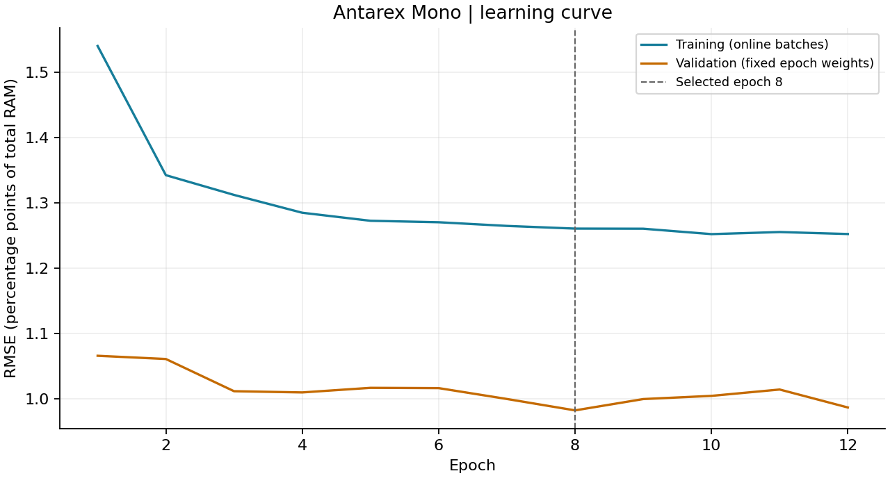
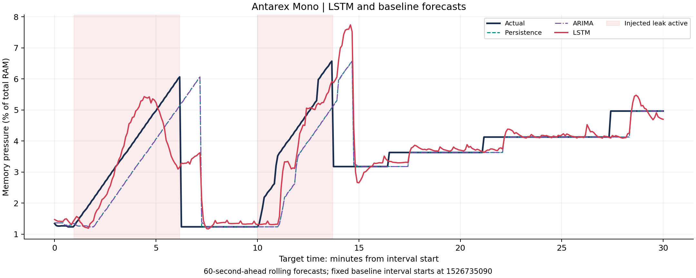
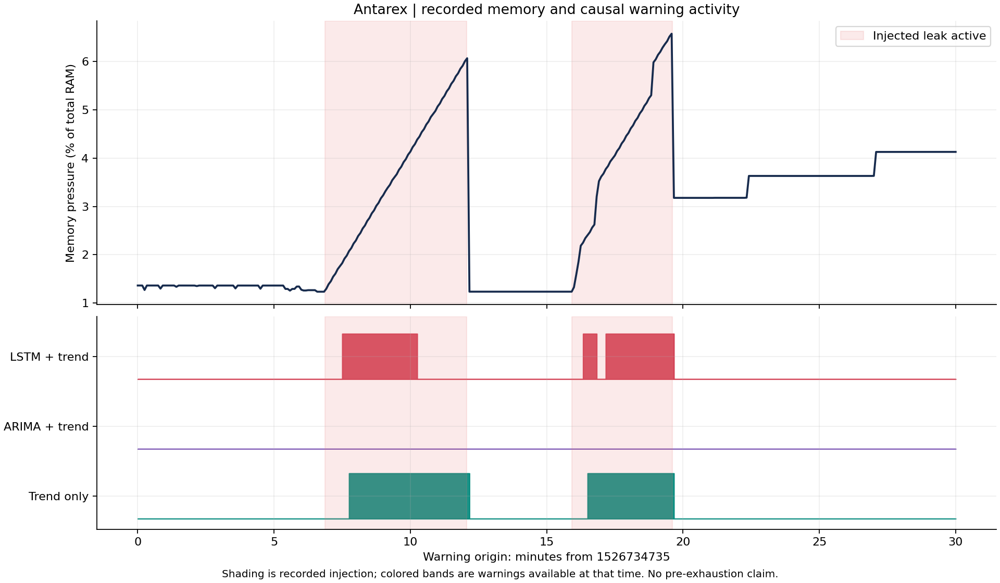

# Review 2: Intermediate Results

**Project:** Predictive Memory Leak Detection Using Time Series Analysis

**Review:** 16 September 2026

**Prepared:** 12 September 2026

This guide presents completed experimental stages and preliminary findings. All forecasting and warning scores below come from the user's verified Google Colab runs. It assembles existing results; no new training, threshold tuning or experiment was performed to prepare this guide.

## 1. Data preparation: usable model inputs

**Show:** The table below and the preprocessing notebook's feature/window construction.

| Recording | Sampling | Model features | Valid rows | Test forecast windows | Leak labels |
|---|---|---:|---:|---:|---|
| Antarex CPU-MEM_mono | 5 seconds | 7 | 207,358 | 31,032 | Recorded controlled leak injections |
| Westermo 1 | 30 seconds | 8 | 85,749 | 12,891 | Unknown |
| Westermo 2 | 30 seconds | 7 | 86,393 | 12,745 | Unknown |
| Westermo 3 | 30 seconds | 8 | 86,401 | 12,891 | Unknown |

**Explain:** Real system telemetry was converted into a consistent memory-pressure target, `1 - available memory / total memory`. Each recording was split chronologically into 70% training, 15% validation and 15% testing. Scaling and constant-feature removal used training data only. Windows never cross a split boundary or a missing-data gap.

Each forecast uses 60 past observations. The horizon is 60 seconds for Antarex and 5 minutes for Westermo. Antarex supplies memory, CPU and page-fault features; its inactive swap and constant monitored disk counters are excluded from the model. Westermo supplies memory, CPU, swap, disk and load features, with constant swap excluded on system 2. The sources remain separate experiments.

There are 464,860 complete preprocessing windows across all splits and four recordings. These overlapping windows are correlated. The LSTM uses spaced training windows to fit within the free-Colab compute budget; all saved validation/test origins are evaluated.

Evidence: [preprocessing checkpoint](../research/PREPROCESSING_RESULTS.md), [data validation](../research/DATA_VALIDATION.md), [notebook 01](../notebooks/01_preprocessing_colab.ipynb). These checkpoint documents preserve the status at their original dates; the later stages are complete as reported below.

## 2. Baselines: a measured starting point

**Show:** Antarex test errors from three simple forecasting methods.

| Forecasting method | MAE | RMSE |
|---|---:|---:|
| Persistence: predict the current value | 0.361399 | 1.516596 |
| Linear extrapolation of recent history | 0.377387 | 1.743690 |
| ARIMA baseline | 0.362521 | 1.516401 |

Errors are **percentage points of total RAM**, not accuracy percentages. MAE summarizes absolute error; RMSE gives more weight to larger errors. Lower is better for both.

**Explain:** ARIMA and persistence are almost tied on Antarex RMSE, while simple linear extrapolation is worse. A complex forecasting method must therefore be compared against these measured baselines. Their settings were chosen on validation data before test scoring.

Evidence: [complete forecasting metrics](../results/lstm_colab/metrics.csv), [baseline protocol](../research/BASELINE_PROTOCOL.md), [notebook 02](../notebooks/02_baselines_colab.ipynb).

## 3. Training progress: the LSTM learning curve

| Antarex training checkpoint | Validation RMSE, percentage points |
|---|---:|
| Epoch 1 | 1.065598 |
| Epoch 8: selected checkpoint | 0.981917 |
| Epoch 12: final epoch run | 0.986340 |

**Explain:** A single 32-unit LSTM layer was trained for each recording using seed 42 and CPU execution in free Colab. For Antarex, epoch 8 had the lowest validation RMSE. Training stopped after four subsequent epochs without a new validation minimum, and the epoch-8 model was retained. The test set did not select the epoch.

The training curve measures online batches while weights are changing; the validation curve uses fixed epoch weights on a different time period. Their relative heights alone do not prove or disprove overfitting.

Evidence: [training history](../results/lstm_colab/antarex_mono/training_history.csv), [selected model](../results/lstm_colab/antarex_mono/selected_model.json), [LSTM protocol](../research/LSTM_PROTOCOL.md), [notebook 03](../notebooks/03_lstm_colab.ipynb).

## 4. Forecasting: actual versus predicted memory pressure

**Explain the figure:** The dark line is measured memory pressure and the red line is the LSTM forecast. The horizontal axis is the forecast's target time; each Antarex forecast was produced using observations ending 60 seconds earlier. Pink shading marks recorded leak injection, not a predicted alarm. This fixed example interval was inherited from the baseline experiment. The LSTM sometimes overshoots and does not perfectly reproduce abrupt changes.

The following scores use the complete held-out test windows, rather than only this illustrated interval.

| Recording | ARIMA MAE | LSTM MAE | ARIMA RMSE | LSTM RMSE | Relative RMSE reduction vs ARIMA |
|---|---:|---:|---:|---:|---:|
| Antarex mono | 0.362521 | 0.358119 | 1.516401 | 1.216399 | 19.78% |
| Westermo 1 | 0.092984 | 0.099499 | 0.317915 | 0.295990 | 6.90% |
| Westermo 2 | 0.104707 | 0.116579 | 0.291166 | 0.257544 | 11.55% |
| Westermo 3 | 0.229737 | 0.251230 | 0.658167 | 0.608003 | 7.62% |

All MAE/RMSE values are percentage points of total RAM. Relative reduction is `(ARIMA RMSE - LSTM RMSE) / ARIMA RMSE × 100`.

**Finding:** LSTM has lower RMSE than ARIMA on all four pilot recordings, but ARIMA has lower MAE on all three Westermo recordings. These single-seed findings do not establish statistical significance or uniform superiority.

Additional figures: [all four forecasting methods compared](../results/lstm_colab/test_error_comparison.png), [Westermo 1 actual versus predicted](../results/lstm_colab/westermo_1/first_test_day.png). Evidence: [metric CSV](../results/lstm_colab/metrics.csv), [Colab forecasting verification](../research/COLAB_LSTM_VERIFICATION.md).

## 5. Leak warnings: classification and event outcomes

**Explain the figure:** Pink regions show recorded injected-leak intervals. The lower colored bands show when each rule issued warnings using information available at that time. This plot uses the warning origin time, whereas the forecasting plot above uses target time; their interval starts differ.

The trend-only rule requires sustained observed memory growth. The forecast-assisted rules additionally require predicted growth. A warning needs three consecutive qualifying observations. Thresholds were selected using validation F1 and frozen before test scoring: 0.8 percentage points/minute for trend only and 0.4 for LSTM plus trend.

There are 31,032 scored Antarex test timestamps, including 1,933 leak-active timestamps, and 35 fully covered eligible test leak events.

| Warning rule | Precision | Point recall | Point F1 | False alarm starts / non-leak hour | Events detected | Median delay, detected events only |
|---|---:|---:|---:|---:|---:|---:|
| Trend only | 0.802028 | 0.859286 | 0.829670 | 2.127908 | 35 / 35 | 30 seconds |
| LSTM + trend | 0.847601 | 0.466115 | 0.601469 | 1.039211 | 34 / 35 | 31 seconds |
| ARIMA + trend | Undefined | 0.000000 | 0.000000 | 0.000000 | 0 / 35 | Undefined |
| Always off control | Undefined | 0.000000 | 0.000000 | 0.000000 | 0 / 35 | Undefined |

Precision, recall and F1 are fractions. Point recall measures the share of leak-active timestamps warned on. Event detection requires a new warning start inside an eligible leak interval, so detecting an event does not mean warning throughout its duration. Delay is measured after injection onset and excludes missed events. Non-leak timestamps can contain other injected faults.

The ARIMA-assisted rule selected the disabled option because every candidate in its fixed validation threshold grid generated no warnings. Its precision and detection delay are undefined. This result concerns the implemented forecast-growth rule and grid, not every possible ARIMA detector.

**Finding:** The LSTM-assisted rule increases precision and reduces false alarms, but sacrifices point recall and F1 relative to the trend-only rule. Improved forecasting RMSE does not automatically produce a better leak detector. This tradeoff is a substantive preliminary research result.

Evidence: [point metrics](../results/warnings_colab/antarex_point_metrics.csv), [event metrics](../results/warnings_colab/antarex_event_metrics.csv), [warning protocol](../research/WARNING_PROTOCOL.md), [Colab warning verification](../research/COLAB_WARNING_VERIFICATION.md), [notebook 04](../notebooks/04_leak_warning_colab.ipynb). Optional supporting figure: [confusion matrices](../results/warnings_colab/antarex_confusion_matrices.png).

## 6. Scope of the current evidence

The working pilot demonstrates data preparation, memory forecasting and recognition of controlled injected leaks. The Antarex block reaches approximately 42.24% memory pressure and has no observed 80% threshold crossing. These results do not demonstrate warning before exhaustion or crash prevention. Westermo lacks confirmed leak labels and supports workload forecasting and descriptive alarm counts only.

Dataset validation and the experimental showcase requirements are complete for this pilot. The research-paper draft remains the core outstanding requirement for the 75% milestone. Broader labeled data, repeated seeds, uncertainty estimates, ablation studies and deployment evaluation remain later work. No overall completion percentage is assigned without an agreed weighting.

## Suggested review demonstration: 6-8 minutes

1. **Data preparation:** show the first table and explain the chronological split, features and forecast horizon.
2. **Baselines:** explain persistence and show why an ARIMA baseline alone offers little Antarex RMSE improvement.
3. **Learning curve:** point to epoch 8 and explain validation-based checkpoint selection.
4. **Forecasting:** show the actual-versus-predicted figure and the full-test comparison table.
5. **Warnings:** show the warning timeline and explain the precision/recall tradeoff. Distinguish timestamp recall from event detection.
6. **Remaining work:** state the paper-draft status and the limits of the current pilot.

In VS Code, open this Markdown file and press **Ctrl+Shift+V** to preview it with the figures. Keep the linked PNG/PDF figures and metric CSVs available locally for the review. Use the notebooks to explain the implementation and the verified `results/lstm_colab` and `results/warnings_colab` files for the reported scores. A fresh training run is not necessary merely to display these intermediate results.
